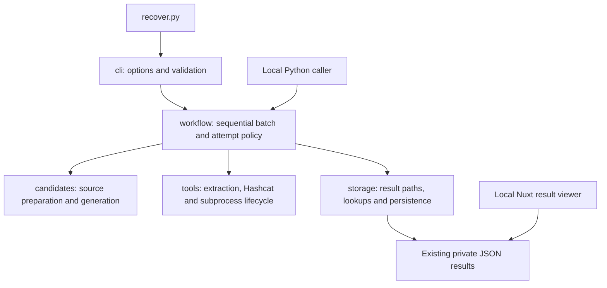

# Local application architecture

Pwnabase remains one local application. The modular refactor preserves the
recovery command and file results while making responsibility ownership explicit.



## Ownership

| Module | Owns |
|---|---|
| `pwnabase.cli` | Argument parsing, validation diagnostics and mapping exit codes |
| `pwnabase.config` | Immutable `RunConfig`/`ToolConfig`, shared validation and project-root defaults |
| `pwnabase.workflow` | Eligibility, skip/retry decisions, sequential attempts, batch lock, snapshots and runtime cleanup |
| `pwnabase.tools` | Record parsing, extractor/Hashcat commands, preflight, child process groups, cancellation, stdin feeding and filtered progress |
| `pwnabase.candidates` | Profile/rule preparation, snapshots of wordlists, behavioral identities, exact-byte generation, streaming and previews |
| `pwnabase.storage` | Content fingerprints, JSON serialization, atomic replacement, outcome paths, provenance and historical-result lookup |

The workflow decides whether to skip or retry. Storage supplies the saved
outcomes without making that policy decision. Candidate preparation describes
the experiment; tools execute it. The frontend remains read-only and separate
from recovery execution.

## Calling the workflow

`python3 recover.py` retains its options and GPU defaults. Project-root defaults
are anchored to the package's parent directory, independently of the caller's
working directory. The package is used directly from this checkout; no package
installation or new runtime dependency is required.

A local Python caller can use `RunConfig` and `workflow.run(config)`:

```python
from pathlib import Path
from pwnabase.config import RunConfig
from pwnabase.workflow import run

result = run(RunConfig(
    handshakes=Path('/tmp/study/captures'),
    wordlist=Path('/tmp/study/words.txt'),
    output=Path('/tmp/study/results'),
    device_types='1',  # Explicit CPU choice for a synthetic experiment.
))
print(result.exit_code, result.counts)
```

`BatchResult` reports the exit code, outcome counts, records encountered and
captures visited. It does not exit the calling process. `AttemptResult` retains
password bytes, status and generation diagnostics, including partial statistics
when a streamed attempt fails. Configuration is separate from prepared candidate
settings, resolved executable paths and runtime counters.

The workflow is synchronous. It retains console logging and the private umask
used by the original command. Its signal handling and process state are intended
for an operator process, not concurrent requests in a web server.

## Compatibility and limitations

Existing output schemas, directory names, filenames, attempt identities, optional
metadata and viewer behavior are preserved. Completed recovery is a global skip;
exhaustion applies to the matching candidate source and transformations. A changed
behavioral identity permits another attempt. Original captures/wordlists are
snapshotted rather than modified.

Ctrl+C terminates tool process groups and joins workers, returning code 130.
Completed files survive; unfinished attempts restart from the beginning. The
batch lock applies to one output location on one machine. It is not a distributed
lock. Failed input processing remains isolated from later eligible inputs; shared
startup failures stop the run.

Transformed wordlist attempts retain one seed's generated candidates at a time
and write bounded temporary candidate batches for Hashcat. Each fully exhausted
batch is confirmed before processing continues; a recovered password can stop
Hashcat partway through its current batch. Batch size adapts to measured
end-to-end generation, file-writing, and Hashcat time toward roughly one minute,
with an explicit maximum. Candidate
deduplication remains per seed. This bounds memory and temporary-file size, not
total work: a large profile can still generate very many candidates. The source
must be fully generated before declaring the attempt exhausted.

Returned diagnostic tails and in-memory parsing are bounded. The inherited
temporary output spool has no disk cap. Raw diagnostic text can contain secrets
and must be filtered before logging or persistence.

Database selection/migration, uploads, wardriving imports, worker protocols,
scheduling and notebook synchronization remain separate work. The future Dell
database, desktop processing and mobile-notebook roles do not introduce network
assumptions into this local workflow.

## Verification

Run from the project root:

Prefer `./scripts/check` for the required fast checks or `./scripts/check --staged`
for the indexed tree. Enable the commit guardrail once per checkout with
`./scripts/install-hooks`. See [the check guide](checks.md) for exact behavior,
dependencies, conflict handling and local enforcement limits.

The individual check commands remain useful for focused development:

```sh
python3 -m py_compile recover.py pwnabase/*.py tests/*.py
python3 -m unittest discover -s tests -v
node frontend/tests/sheets.test.mjs
git diff --check
git diff --cached --check
```

For a real-tool milestone, use
`RUN_REAL_TOOLS=1 python3 -m unittest discover -s tests -v`.
The integrations construct synthetic PMKID/EAPOL captures and small temporary
wordlists, explicitly select the CPU backend, and never process the real capture
directory. Report that backend rather than claiming GPU validation.

The highest acceptance seam is the CLI and its saved outcomes. A direct-workflow
test checks equivalence. Focused tool tests use harmless child processes;
candidate tests check exact bytes, transformations and identities. Contract
fixtures come from pre-refactor commit `4666f55`. Cross-module checks exercise
locking, startup failure, error isolation, interruption/rerun, incomplete streams,
and historical results read by the existing frontend store.
